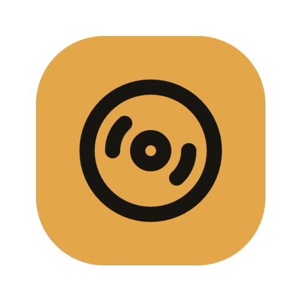

<div align="center">



# Digital Audio Manager

**Your music, on your devices.**

A native desktop library and download manager for Windows, macOS and Linux, with Tubify's design language and secure YouTube Music session manager.

[](LICENSE)


[Getting started](#getting-started) · [Features](#features) · [Building](docs/building.md)

</div>

## Features

- **A familiar native interface.** Tubify's Classic and Midnight Violet palettes, other theme presets, Roboto typography, playlist navigation, search and a download queue dock. Built with PySide6 and QML.
- **Your YouTube Music account.** Connect through your browser or import a local `browser.json` export. Sessions use the OS keyring, with validation, renewal, reconnect and sign-out. Credentials are independent from Tubify.
- **Public imports too.** Import a playlist or album into Unsorted, or sync a public profile without signing in. Connected accounts can sync their library playlists.
- **Exact-video downloads.** Durable queue, retry, cancellation, metadata and artwork. The app keeps M4A/AAC where possible and uses 320 kbps MP3 as a compatibility fallback. It never substitutes a search result for the requested video.
- **Music where you want it.** New installs use the system Music folder inside `Digital Audio Manager/Library`. Choose another Music folder for future downloads; earlier downloads retain their original locations.
- **Device exports.** Choose a mounted device or Music folder, select collections, preview changes and sync. Files are staged and verified inside `Digital Audio Manager`; the 8,000-file guard remains.
- **Local access.** Browse your catalog offline and open downloads with the system music player. Signing out keeps downloaded music.

Direct integration with Tubify is planned for later. The apps currently keep separate settings, credentials and databases.

## Getting started

This branch contains the native replacement. Existing published releases may still contain the earlier app; native package publication is a separate maintainer step.

From source, install Python 3.12 or later, then:

```sh
python -m venv .venv
# Linux/macOS:
. .venv/bin/activate
# Windows PowerShell: .venv\Scripts\Activate.ps1
python -m pip install -e .
digital-audio-manager
```

1. Click the account icon at the top right to **Sign in via Browser**. Use **Import Music** in the sidebar to sync your playlists or add a public playlist/album URL.
2. Install FFmpeg and ffprobe on your computer. **Settings → Troubleshooting → Set Up Tools** installs Node.js when needed; yt-dlp is included with the app.
3. Open a collection and choose **Download**, then start the queue with the download button in the bottom bar. Individual songs have download icons and overflow menus.
4. Under **Settings → Downloads**, choose the Music folder where future downloads should live.
5. To export to a music player, open **Devices**, choose its folder, select playlists, then **Preview → Sync device**.

On Windows, Firefox can be used when Chrome or Edge's cookie encryption prevents browser import. On macOS, the system may ask for keychain or browser-file access. A locked or unavailable secure keyring produces a reconnect message; public imports and existing downloads remain available.

## Storage and updates

Existing `MP3 Maker` and `Digital Audio Manager` catalogs are detected in place. The database remains `mp3-maker.sqlite3`, and `MP3_MAKER_APP_DATA` / `MP3_MAKER_LIBRARY` overrides continue to work. New app data uses the platform's standard data directory. New music uses its standard Music directory, including localized folders.

Changing the download folder does not move or delete earlier downloads. Keep their original drive connected when opening or exporting them. **Reset local library** clears the current download folder and catalog after confirmation; device exports and files in previous download locations remain.

There is no automatic updater. Native packages include Python and Qt and are unsigned. Build instructions, verification commands and platform packaging details are in [docs/building.md](docs/building.md).

## Contributing

Changes start with a Linear issue. Follow [AGENTS.md](AGENTS.md) for branches, commits, code quality, native tests and release gates. CI checks all three platforms on pull requests. Keep browser sessions and personal library data out of reports and commits.

## License

MIT; see [LICENSE](LICENSE). Tubify-derived code, Roboto and Lucide notices are preserved in [the asset notices](native/src/dam/assets/THIRD_PARTY_NOTICES.md). Dependencies and external runtime tools retain their own licenses.

Digital Audio Manager is an independent project, unaffiliated with Google or YouTube. Only download media you have the right to keep.
